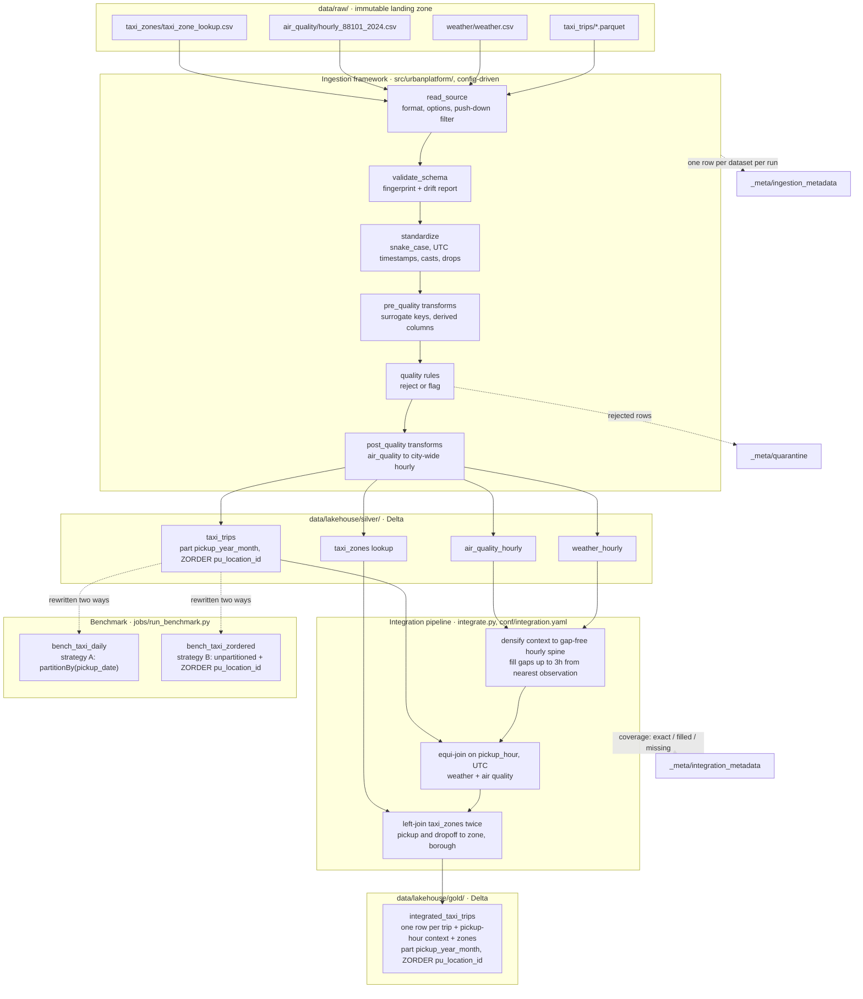

# Architecture Diagram

## Notes

- No bronze table. `data/raw/` is the immutable landing zone and transforms replay from the files.
  See [Storage Architecture §1](storage_architecture.md).
- The ingestion framework carries no dataset name. Everything is driven by
  `conf/datasets/<name>.yaml` except the `pre_quality` and `post_quality` transforms, reached
  through a registry.
- Silver tables share their join keys, the UTC `pickup_hour` and `obs_hour` and the `location_id`,
  so integration is one broadcast join per context table. Gap-filling runs on the context tables
  before the join.
- The `air_quality` filter is applied during the raw scan, not after landing.

Sizes, row counts and timings are in the [Design Report](design_report.md).
